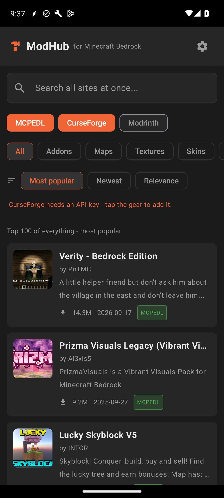
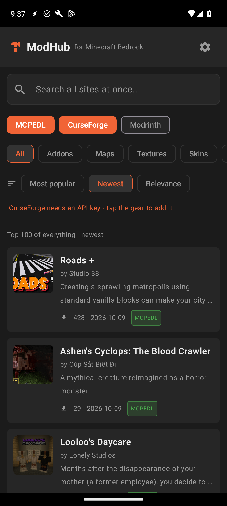
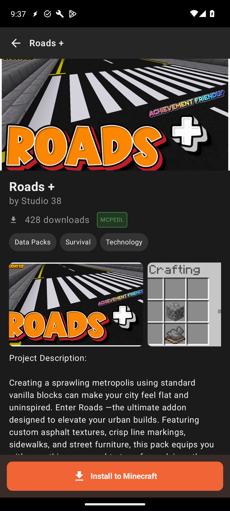
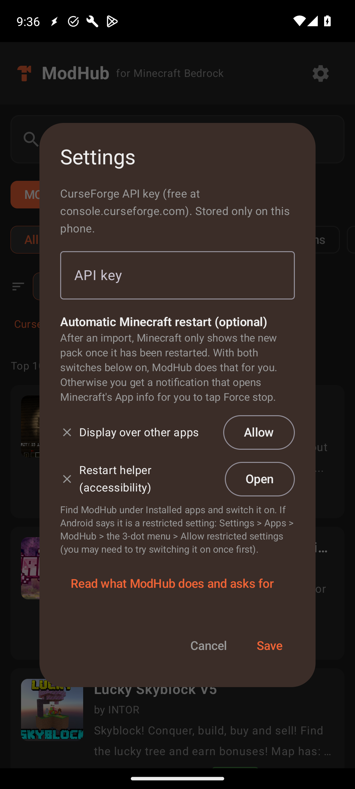

# ModHub for Minecraft Bedrock

**Browse addons, maps, texture packs and skins from MCPEDL, CurseForge and Modrinth in one place, and send them to Minecraft Bedrock with one tap.**

Free. Open source. No ads, no accounts, no analytics.

[](https://github.com/magicmanat1492/modhub-for-minecraft-bedrock/releases/latest)
[](https://ko-fi.com/magicman1446)

<p>




</p>

## Features

- Search MCPEDL, CurseForge and (optionally) Modrinth at once; duplicates are merged.
- Home page shows the top 100 per category: Most popular, Newest, Relevance.
- Filters for Addons, Maps, Textures, Skins and more.
- Full descriptions, screenshots, version picker, and an "installed" marker.
- One-tap **Install to Minecraft**: downloads the file and hands it to Minecraft to import.
- Optional automatic Minecraft restart so new packs show up, with a notification fallback.
- You switch packs on yourself, because some addons can break a world.

## Install

1. Download `ModHub-vX.Y.apk` from the [latest release](https://github.com/magicmanat1492/modhub-for-minecraft-bedrock/releases/latest) and open it. Allow "install unknown apps" for your browser/file manager when asked.
2. (Optional) Verify the file against `SHA256SUMS.txt` from the release. Release signing certificate SHA-256:
   `D5:5C:8B:F3:67:85:59:AA:90:60:5F:63:B1:4A:B3:A6:A7:C5:80:CC:D4:2C:6C:BC:0E:FC:FA:85:C1:3E:CE:9F`
3. Open ModHub and read the first-run note. It explains every permission.
4. Requires Android 9+ and Minecraft Bedrock (`com.mojang.minecraftpe`) installed.

### Optional: automatic restart

Minecraft only lists a new pack after it restarts. ModHub can do that for you if you grant two permissions in its Settings: **Display over other apps** and the **Restart helper** accessibility service. The service is limited by its own declaration to the Android Settings app and only presses "Force stop" and "OK" on Minecraft's App info page. If Android calls it a "restricted setting": Settings > Apps > ModHub > 3-dot menu > Allow restricted settings. Skip both and you simply get a notification to restart by hand.

### Optional: CurseForge key

CurseForge needs a free API key from <https://console.curseforge.com>. Paste it in Settings. It is stored only on your phone and sent only to CurseForge.

## FAQ

**Is it safe?** The source is here, there are no trackers, and the app only talks to the sites you search. The permissions are explained in-app and in [PRIVACY.md](PRIVACY.md).

**Why are some CurseForge mods missing a download button?** Their authors opted out of third-party downloads. ModHub respects that and offers "Open website" instead.

**Why isn't it on Google Play?** Accessibility-based helpers are hard to get approved, and this is a hobby project.

## Build

```
./gradlew assembleDebug
```
Release signing is optional: put a `keystore.properties` (storeFile, storePassword, keyAlias, keyPassword) next to `build.gradle`, or point `MODHUB_KEYSTORE_PROPS` at one.

## Disclaimer

ModHub is an independent, unofficial project. It is **not affiliated with, endorsed by, or sponsored by** Mojang Studios, Microsoft, CurseForge, Overwolf, MCPEDL or Modrinth. Minecraft is a trademark of Mojang/Microsoft. All content shown belongs to its authors; ModHub only links to and downloads files from the original sites, uses an honest User-Agent, and respects author download opt-outs. Use addons at your own risk and back up your worlds.

## License

[MIT](LICENSE)
